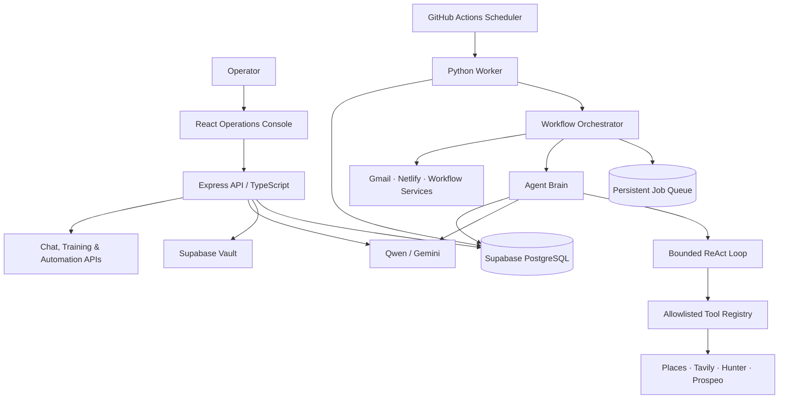

# Irzam Studio — Intelligent Agentic Automation Framework

<p align="center">
  <strong>A Python-based Intelligent Agentic Automation Framework, inspired by the agent experience of Base44 Superagents.</strong>
  <br />
  A persistent, tool-using agent runtime with a web operations console, API layer, and cloud-backed execution workflow.
</p>

<p align="center">
  
  
  
  
  
</p>

<p align="center">
  <a href="https://github.com/Irzam786/Irzam-Studio-Autonomous-Agent">Repository</a>
  ·
  <a href="#architecture">Architecture</a>
  ·
  <a href="#quick-start">Quick start</a>
  ·
  <a href="#roadmap-fully-completing-core-execution-engine">Roadmap</a>
</p>

---

## Overview

**Irzam Studio** is a Python-based agentic automation framework built around a bounded **ReAct (Reasoning + Acting) execution loop**, a schema-driven tool registry, model-provider adapters, and persistent application state.

The project combines a Python execution engine with a TypeScript/Express API and a React operations interface. This separation gives the agent a dedicated runtime for reasoning and tool execution while the surrounding application manages configuration, connected services, workflows, records, and operator interaction.

The design takes inspiration from the autonomous-agent experience offered by products such as **Base44 Superagents**. Irzam Studio is an independent implementation with its own execution runtime, integrations, persistence layer, and application architecture. It is not affiliated with or endorsed by Base44.

### Design goals

- Give an AI agent access to multiple explicitly registered tools.
- Turn natural-language goals into bounded, observable execution steps.
- Keep operational context, task state, and application records in persistent storage.
- Connect external services through replaceable provider adapters.
- Make scheduled and manually triggered workflows manageable from one operations interface.
- Keep credentials and provider configuration outside model-generated tool arguments.

## Core capabilities

### 1. Agentic reasoning and execution

- Python ReAct loop that alternates between model decisions, registered tool calls, and final responses.
- Bounded execution iterations to keep an agent run controlled.
- Structured handling for tool calls, final answers, pauses, and execution errors.
- Task identifiers, execution status, checkpoints, and event records.
- Provider selection between the configured Qwen and Gemini adapters.

### 2. Multi-tool use and orchestration

- Schema-defined tool registration and execution through a central `ToolRegistry`.
- Explicit allowlisting: unknown or unregistered tools are rejected.
- Model function/tool calling through provider adapters.
- Current research tools include Google Places business discovery, Tavily web research, and Hunter.io / Prospeo email discovery and verification.
- Workflow orchestration for scheduled jobs, lead discovery, inbox processing, outreach queue handling, and reporting.

The model-facing default research registry is intentionally constrained. Operational actions such as outreach dispatch are handled by dedicated workflow code rather than being exposed as unrestricted model-selected tools.

### 3. Webhook and event integration foundations

- Express HTTP API routes expose application functions for chat, integrations, campaigns, training rules, automation triggers, leads, and related workflows.
- Automation trigger endpoints provide an entry point for external systems and operator-driven events.
- Provider connectors are separated from the agent loop so additional event sources can be integrated without coupling them to reasoning logic.

**Webhook direction:** standardized inbound webhook receivers, signature verification, event normalization, and outbound webhook delivery are part of the execution-engine roadmap. The current repository provides the API and automation-trigger foundation; it does not claim a complete generic webhook gateway.

### 4. Long-context memory foundations

Irzam Studio uses Supabase-backed persistence for application and agent context, including:

- Chat sessions and their stored message history.
- Training conversations and reusable operational rules.
- Agent task goals, state, and checkpoints.
- Task execution events and status history.
- Persistent business, campaign, outreach, inbox, and demo records.

This provides a durable foundation for context across application sessions and worker runs. Runtime context windows remain bounded by the active model request and execution flow; advanced context compaction, semantic retrieval, and memory selection across large histories are planned enhancements.

### 5. Model-provider adapters

- **FreeLLMAPI / Qwen:** OpenAI-compatible chat-completion adapter with function/tool-call parsing.
- **Google Gemini:** adapter for Gemini model responses and native function declarations.
- Provider selection can be configured for an agent task.
- Provider credentials are retrieved server-side from Supabase Vault or the runtime environment.

### 6. Persistent jobs and scheduled execution

- Supabase-backed agent job queue and schedule records.
- Queue operations for enqueuing due schedules, claiming work, recording completion, and recording failures.
- Worker orchestration with bounded job batches.
- GitHub Actions workflow configured to invoke the Python worker on a recurring schedule and through manual dispatch.
- Task and workflow events are recorded for operational visibility.

The checked-in GitHub Actions worker currently sets `DRY_RUN=true`. Live actions should only be enabled after the deployment environment, credentials, safeguards, and operational policies have been reviewed.

### 7. Integrations and application services

The repository contains provider adapters and service modules for:

| Integration area | Current implementation |
|---|---|
| AI reasoning | FreeLLMAPI / Qwen and Google Gemini adapters |
| Business discovery | Google Places API |
| Web research | Tavily Search |
| Contact enrichment | Hunter.io and Prospeo |
| Email workflows | Gmail OAuth relay, sending and reply scanning modules |
| Demo deployment | Netlify deployment connector |
| Persistence and secrets | Supabase PostgreSQL and Vault-backed secret access |

Integrations require valid credentials and provider-side permissions. A connector being present in the codebase does not mean the corresponding account is already connected or enabled in a deployment.

## Architecture

Irzam Studio is organized into three cooperating layers:

1. **Operations and API layer** — React 19, TypeScript, Vite, and Express provide the operator-facing interface and application API.
2. **Agent execution layer** — Python 3.11 hosts the agent brain, model adapters, ReAct loop, tool registry, state manager, connectors, and workflow orchestrator.
3. **Persistence and scheduling layer** — Supabase PostgreSQL stores application data, tasks, checkpoints, events, and operational rules; Supabase Vault stores provider credentials; GitHub Actions invokes the worker.



### Repository layout

```text
.
├── agent/
│   ├── brain.py                 # Agent entry point and provider selection
│   ├── react_loop.py            # Bounded reasoning/action loop
│   ├── tool_registry.py         # Allowlisted, schema-based tools
│   ├── orchestrator.py          # Scheduled workflow orchestration
│   ├── state_manager.py         # Task state, checkpoints and events
│   ├── llm/                     # Qwen and Gemini adapters
│   ├── connectors/              # Research and provider connectors
│   └── repository/              # Supabase persistence adapter
├── server/
│   ├── app.ts                   # Express API and application routes
│   └── services/                # Agent, connector, database and Gmail services
├── src/
│   ├── components/              # React operations interface
│   ├── lib/                     # Client-side service configuration
│   └── App.tsx                  # Application shell
├── scripts/                     # Supporting automation and service scripts
├── supabase/
│   └── migrations/              # Database schema and durable queue migrations
├── netlify/
│   └── functions/               # Netlify function entry point
├── .github/
│   └── workflows/               # Worker, validation and deployment workflows
├── .env.example                 # Environment variable template
├── package.json
└── README.md
```

## Technology stack

| Layer | Technologies |
|---|---|
| Agent runtime | Python 3.11 |
| Agent pattern | ReAct, model function calling, schema-driven tool registry |
| Model providers | FreeLLMAPI / Qwen, Google Gemini |
| API server | Node.js, Express, TypeScript |
| Operations UI | React 19, Vite, Tailwind CSS |
| Database | Supabase PostgreSQL |
| Credential storage | Supabase Vault and environment variables |
| Worker scheduling | GitHub Actions |
| External services | Google Places, Tavily, Hunter.io, Prospeo, Gmail, Netlify |

## Quick start

### Prerequisites

- Python 3.11
- Node.js and npm
- A Supabase project with the repository migrations applied
- Credentials for the model provider and any external connectors you intend to use

### 1. Clone the repository

```bash
git clone https://github.com/Irzam786/Irzam-Studio-Autonomous-Agent.git
cd Irzam-Studio-Autonomous-Agent
```

### 2. Configure environment variables

```bash
cp .env.example .env
```

Set the required values in your local `.env` file:

```env
SUPABASE_URL=https://YOUR_PROJECT.supabase.co
SUPABASE_SERVICE_ROLE_KEY=YOUR_SUPABASE_SERVICE_ROLE_KEY
SESSION_SECRET=YOUR_RANDOM_SECRET_AT_LEAST_32_CHARACTERS
PORT=3000
NODE_ENV=development
```

Add optional provider credentials only when you need those integrations. Never commit real API keys, OAuth tokens, service-role keys, or private owner credentials.

### 3. Install JavaScript dependencies and start the application

```bash
npm install
npm run dev
```

The Express/Vite development server starts on port `3000` by default.

### 4. Install Python worker dependencies

```bash
python -m venv .venv
```

Activate the environment:

```bash
# macOS / Linux
source .venv/bin/activate

# Windows PowerShell
.venv\Scripts\Activate.ps1
```

Install the worker requirements:

```bash
pip install -r agent/requirements.txt
```

Run the worker:

```bash
python -m agent.main
```

The worker requires valid Supabase access. Its configuration defaults to dry-run mode unless explicitly changed in the runtime environment.

### 5. Validate the application

```bash
npm run lint
npm run build
```

These commands run the configured TypeScript check and frontend production build.

## Configuration and security

- Keep secrets in environment variables or the configured Supabase Vault flow.
- Use a private, randomly generated `SESSION_SECRET` with at least 32 characters.
- Keep the Supabase service-role key server-side; never expose it in browser code.
- Do not pass provider credentials as model-generated tool arguments.
- Agent tool execution is restricted to registered tools.
- Keep worker dry-run safeguards enabled while validating integrations and workflow behavior.
- Review provider permissions, rate limits, data handling terms, and applicable outreach requirements before enabling external actions.
- Do not commit `.env`, access tokens, OAuth refresh tokens, or production credentials.

## Roadmap: Fully completing core execution engine

The roadmap focuses on strengthening the framework's execution capabilities, extensibility, and reliability.

### Execution engine

- Expand the bounded ReAct runtime with configurable execution policies, cancellation, and more granular tool-call lifecycle handling.
- Improve structured tool results, validation, retries, timeouts, and recovery behavior.
- Add reusable execution plans and richer task resumption from persisted checkpoints.

### Long-context memory

- Add context-window budgeting and intelligent conversation summarization.
- Implement relevance-based memory retrieval across chat sessions, training rules, task history, and knowledge records.
- Add memory consolidation, deduplication, retention policies, and operator-controlled memory inspection.

### Webhook and event infrastructure

- Build reusable inbound webhook endpoints with provider signature verification.
- Normalize incoming events into a common event envelope.
- Add configurable outbound webhooks, delivery retries, replay protection, and event logs.
- Connect external events to approved agent workflows through explicit policies.

### Tool and provider ecosystem

- Formalize a reusable connector interface and consistent tool schemas.
- Expand provider adapters and tool registration patterns.
- Add connector health checks, capability discovery, and integration-level observability.

### Reliability and developer experience

- Expand automated tests for the ReAct loop, tool registry, state persistence, queue lifecycle, and provider adapters.
- Add structured tracing, metrics, and clearer execution diagnostics.
- Improve local development documentation and deployment profiles.

## Contributing

Contributions, bug reports, and architectural feedback are welcome. Before proposing a substantial change:

1. Open an issue describing the use case or problem.
2. Keep changes focused and include tests or reproducible validation where applicable.
3. Document new tools, provider configuration, and required environment variables.
4. Never include credentials or private operational data in commits or issue reports.

## Project note

Irzam Studio is an actively evolving engineering project. The repository documents the current implementation and the planned direction of the framework. Integration availability depends on deployment configuration, provider credentials, and service permissions.

**Base44** is referenced only as product inspiration. Irzam Studio is independently developed and is not an official Base44 product.
